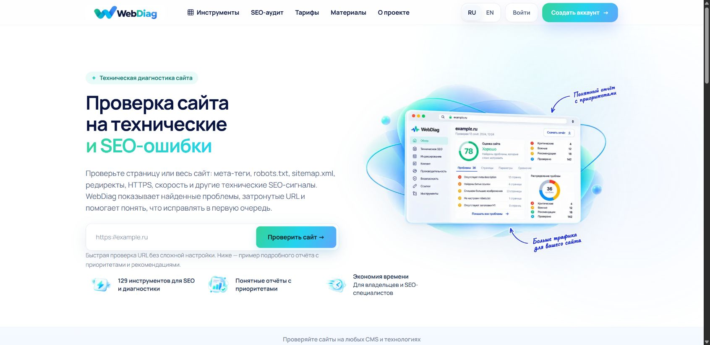

# WebDiag

[Русский](README.md) | **English**

A service for technical website diagnostics, SEO audits, and monitoring. It helps identify page issues, prioritize fixes, and track a project's condition after changes.

[Open WebDiag](https://webdiag.ru/en) · [Tool catalog](https://webdiag.ru/en/tools) · [Account](https://app.webdiag.ru) · [Russian interface](https://webdiag.ru)



## The problem it solves

Checking a website often means using separate tools for meta tags, redirects, page availability, performance, and domain settings. Results end up scattered across services, making repeated checks difficult to compare.

WebDiag brings these tasks together: individual tools support focused diagnostics, project audits collect issues across multiple pages, and history and monitoring help track results over time.

## Features

The catalog contains **129 tools: 115 utilities and 14 AI tools**. The interface is available in Russian and English.

| Task | What you can do |
| --- | --- |
| Page diagnostics | Identify issues with meta tags, indexing, redirects, links, images, and other technical elements. |
| Site audits | Start a crawl from a project and review prioritized issues with affected URLs. |
| Performance and infrastructure | Check available loading metrics, HTTPS, DNS, and server response settings. |
| Project management | Save audits and reports, browse history, and repeat checks after fixes. |
| Monitoring | Schedule project checks and review their results. |
| Everyday utilities | Work with JSON, text, encodings, images, colors, and CSS using browser tools. |
| AI assistants | Prepare an action plan, content brief, metadata variants, structured data, or images from the information you provide. |

A quick check analyzes one URL. A project crawl is limited to 100 pages by default and analyzes the returned HTML without executing JavaScript. Some external measurements depend on their data sources; unavailable data is identified in the results.

## Try it

1. Open the [homepage](https://webdiag.ru/en) and enter a website or page URL.
2. Start the check and review the issues and recommendations.
3. Use the [individual tools](https://webdiag.ru/en/tools) to examine a specific issue in more detail.
4. Create an account and add a project to access audit history and scheduled checks.

## Engineering decisions

- **Shared tool catalog.** Tool metadata, categories, and availability are defined centrally and validated during the build.
- **Separate responsibilities.** The interface, server-side diagnostics, and background checks run in separate applications. Long-running tasks have persisted state and execution time limits.
- **Access control.** Projects, reports, and check results are associated with their owner. Access checks run on the server and are covered by tests.
- **Validated results.** Request failures and unavailable data are distinguished from successful checks. AI responses are validated against the structure and requirements of each tool before they are saved.
- **External requests.** Server-side requests have limits on duration, response size, and allowed destinations. Integration credentials remain on the server.

## Stack and structure

| Component | Technologies | Source |
| --- | --- | --- |
| Interface and web application | TypeScript, React, Next.js | [apps/web](apps/web) |
| API and data storage | Python, FastAPI, SQLite | [apps/api](apps/api) |
| Background tasks | Python | [apps/worker](apps/worker) |
| Shared contracts and utilities | TypeScript | [packages/tool-core](packages/tool-core) |
| Tool registry | Typed definitions and localization | [packages/tool-registry](packages/tool-registry) |

Docker is used for containerization and GitHub Actions for automated checks. The current architecture targets a single deployment with shared data storage.

## Quality checks

Vitest and pytest cover interface logic, the API, and background tasks. Playwright checks user flows, responsive layouts, keyboard navigation, and accessibility. Additional checks cover access control, error handling, and retries.

The CI workflow also runs TypeScript, ESLint, Ruff, catalog validation, a production build, and container image checks. The configuration is available in [GitHub Actions](https://github.com/fedorovich-web/webdiag/actions).

After installing the dependencies, run the complete local verification suite with:

```sh
npm run verify:local
```

Exact dependency versions are recorded in the repository's lock files.

## Author and use of the source code

A project by [fedorovich-web](https://github.com/fedorovich-web).

The source code is provided for review. No license for free use or redistribution is granted; permission from the author is required for reuse.
