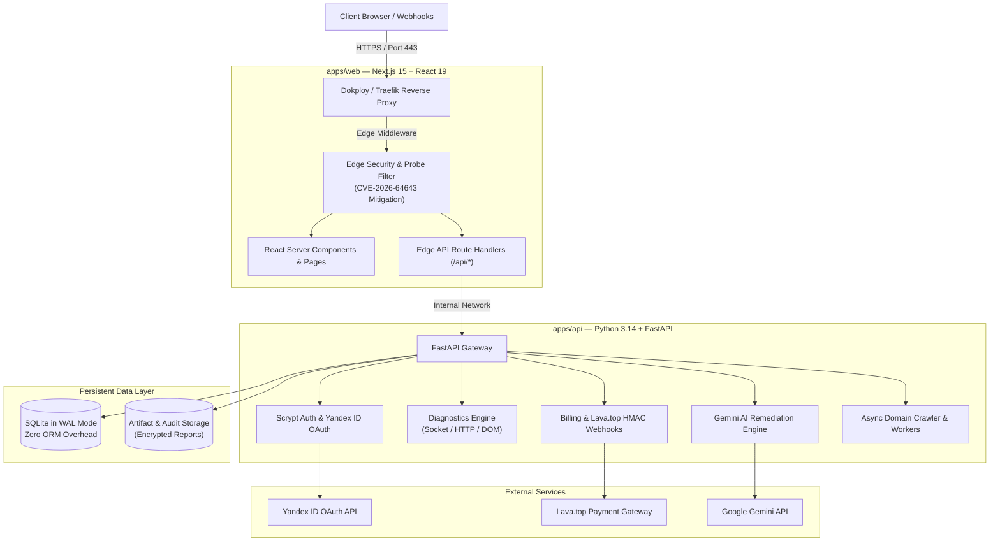

<div align="center">

# WebDiag

**High-Performance Technical SEO, Security Auditing & AI-Driven Remediation Platform**

[](apps/web)
[](packages/tool-core)
[](apps/api)
[](apps/web)
[](apps/web)
[](scripts)
[](#license)

[🌐 Production App (app.webdiag.ru)](https://app.webdiag.ru) • [📖 Documentation](docs) • [🛠 Tool Catalog](https://webdiag.ru)

</div>

---

## 📌 Executive Overview

**WebDiag** is a full-stack, enterprise-grade diagnostic engine and SaaS platform designed for technical SEOs, web security engineers, and digital agencies. Unlike typical toy projects or wrapper apps, WebDiag features a **real asynchronous crawler and execution runtime** that executes deep socket-level, HTTP-level, and DOM-level diagnostics across 125+ tools, coupled with an automated AI remediation engine that synthesizes action plans and patch diffs.

### Key Highlights
- **125+ Native Diagnostic Tools**: Real network probes, SSL/TLS handshake analyses, DNSSEC inspection, Core Web Vitals simulation, schema validation, and accessibility checkers.
- **Fail-Closed Security**: Integrated SSRF protection against RFC 1918 / loopback addresses, strict Pydantic v2 input schemas, and Scrypt password derivation.
- **Production Monorepo**: Decoupled Next.js 15 App Router frontend (`apps/web`), high-throughput Python 3.14 FastAPI core (`apps/api`), and shared TypeScript packages (`packages/tool-core`, `packages/tool-registry`).
- **Resilient Billing & OAuth**: Zero-friction Yandex ID OAuth login alongside email authentication, integrated Lava.top payment gateway with HMAC-SHA256 signature verification and idempotent webhook delivery.
- **1,380+ Automated Tests**: Continuous verification spanning 660+ Vitest tests and 720+ Pytest tests with 0 TypeScript and 0 linter errors.

---

## 🏛 System Architecture



---

## 🛠 Feature Modules

### 1. Diagnostics & SEO Suite (125+ Registered Tools)
- **Technical SEO**: Canonical tag consistency, Robots.txt syntax parser, XML Sitemap hierarchy validator, OpenGraph & Twitter Card validator, hreflang bidirectional verification.
- **Infrastructure & Protocol Security**: TLS 1.2/1.3 cipher suite validation, certificate expiration, HSTS preload compliance, CSP parser, DNS records (A, AAAA, MX, TXT, CAA, DNSSEC).
- **Core Web Vitals & Performance**: TTFB latency analyzer, resource compression (Brotli/Gzip) verification, responsive image srcset checker, HTTP/2 & HTTP/3 ALPN probes.
- **Accessibility & Content Analysis**: WCAG 2.1 color contrast calculation, heading hierarchy validator, image alt text analysis, readability scoring, and semantic DOM integrity.

### 2. Deep Crawler & Scheduled Monitoring
- Asynchronous domain crawling with configurable concurrency, rate limiting, and maximum depth.
- Automated link graph traversal detecting 404 broken links, circular redirects, and orphan pages.
- Cron-driven scheduled monitoring triggering email and webhook alerts on regressions.

### 3. AI Remediation Engine
- Generates context-aware, step-by-step remediation plans for detected site defects.
- Produces code diffs (Nginx/Apache configurations, React components, meta tags, and structured JSON-LD).
- Token-efficient caching and credit-based debiting system.

### 4. Enterprise Identity & Monetization
- **Authentication**: Scrypt password hashing with cryptographically secure salts, session token rotation, and native 1-click **Yandex ID OAuth** integration.
- **Monetization**: Top-tier payment processing through **Lava.top**, supporting credit packs, dynamic invoice generation, and idempotent webhook handlers guarded by HMAC-SHA256 signatures.

---

## 📂 Monorepo Organization

```text
webdiag/
├── apps/
│   ├── web/                     # Next.js 15 App Router frontend (React 19, Tailwind CSS)
│   │   ├── src/app/             # Pages, layouts, metadata, and dynamic routes
│   │   ├── src/features/        # Modular domains (account, billing, audit, tools)
│   │   └── src/middleware.ts    # Edge request filter, auth guards & vulnerability shields
│   ├── api/                     # Python 3.14 FastAPI backend
│   │   ├── src/webdiag_api/     # Core domain logic, crawler, audit engines, AI modules
│   │   └── tests/               # 720+ Pytest tests covering APIs, tools, and security
│   └── worker/                  # Background worker processes for long-running crawls
├── packages/
│   ├── tool-core/               # Shared TypeScript schemas, contracts, and scoring models
│   └── tool-registry/           # 125+ registered tool definitions, i18n copy, and categories
├── scripts/                     # Rigorous CI/CD verification gates and lockfile integrity scripts
└── deploy/                      # Docker Compose configs, Dokploy templates, and Caddyfile
```

---

## 🔬 Engineering Standards & Code Quality

WebDiag adheres to uncompromising engineering standards:

| Metric | WebDiag Benchmark | Status |
| :--- | :--- | :--- |
| **Vitest Tests** | 661 tests across 139 suites | ✅ **100% Passed** |
| **Pytest Tests** | 722 tests across API, crawler, and tools | ✅ **100% Passed** |
| **TypeScript Coverage** | Strict mode enabled across all 3 workspaces | ✅ **0 Errors** |
| **Frontend Linter** | ESLint with React Compiler & Next.js rules | ✅ **0 Errors** |
| **Backend Linter** | Ruff checking PEP 8, import sorting, and complexity | ✅ **0 Errors** |
| **Zero-ORM Philosophy** | Direct parameterized SQLite queries with WAL mode | ✅ **Optimal Latency** |
| **Security Architecture** | Edge mitigation of CVE-2026-64643, SSRF blocker | ✅ **Hardened** |

---

## 🚀 Quickstart & Local Development

### Prerequisites
- **Node.js**: `22.x` (LTS)
- **Python**: `3.14.x`
- **npm**: `10.9.x`

### 1. Clone & Install Dependencies

```bash
git clone https://github.com/fedorovich-web/webdiag.git
cd webdiag

# Install Node dependencies
npm ci

# Initialize Python virtual environment
python -m venv .venv

# Install locked Python dependencies
npm run python:install
```

### 2. Configure Environment

Copy `.env.example` to `.env` in `apps/api`:

```ini
WEBDIAG_SECRET_KEY="your-cryptographic-secret"
WEBDIAG_CORS_ORIGINS="http://localhost:3000"
WEBDIAG_YANDEX_CLIENT_ID="your_yandex_client_id"
WEBDIAG_YANDEX_CLIENT_SECRET="your_yandex_client_secret"
WEBDIAG_LAVA_API_KEY="your_lava_api_key"
WEBDIAG_LAVA_WEBHOOK_SECRET="your_lava_webhook_secret"
WEBDIAG_LAVA_OFFER_ID="your_lava_offer_uuid"
```

### 3. Run Quality Verification

Run the full local verification pipeline:

```bash
npm run typecheck       # Verify TypeScript types
npm run lint            # Verify JavaScript / React code
npm run lint:python     # Verify Python code with Ruff
npm test                # Run Vitest test suites (660+ tests)
npm run test:python     # Run Pytest test suites (720+ tests)
npm run verify:registry # Validate all 125 tools against schema
```

### 4. Run Development Servers

```bash
# Terminal 1 — Next.js frontend (port 3000)
npm run dev

# Terminal 2 — FastAPI backend (port 8000)
node scripts/run-python.mjs -m uvicorn webdiag_api.main:app --reload --port 8000
```

---

## 🚢 Production Deployment

WebDiag is containerized and ready for 1-click deployment via **Docker Compose** or **Dokploy**:

```bash
# Build and run production containers
docker compose -f deploy/docker-compose.dokploy.yml up -d --build
```

---

## 📄 License

Proprietary. All rights reserved © 2026 [WebDiag Team](https://webdiag.ru).
