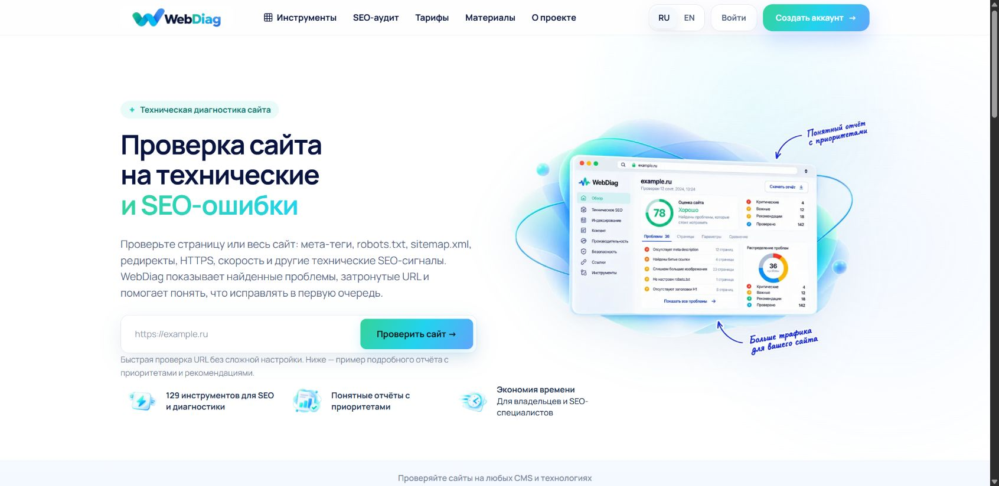

# WebDiag

Сервис для технической диагностики, SEO-аудита и мониторинга сайтов. Помогает найти проблемы страницы, определить приоритет исправлений и следить за состоянием проекта после изменений.

[Открыть WebDiag](https://webdiag.ru) · [Каталог инструментов](https://webdiag.ru/tools) · [Личный кабинет](https://app.webdiag.ru) · [English interface](https://webdiag.ru/en)



## Какую задачу решает

При работе с сайтом часто приходится отдельно проверять мета-теги, редиректы, доступность страниц, скорость и настройки домена. Результаты остаются в разных сервисах, а повторные проверки сложно сопоставить.

WebDiag объединяет эти задачи: отдельные инструменты подходят для точечной диагностики, аудит проекта собирает проблемы нескольких страниц, а история и мониторинг помогают возвращаться к результатам.

## Возможности

В каталоге **129 инструментов: 115 утилит и 14 AI-инструментов**. Интерфейс доступен на русском и английском языках.

| Задача | Что можно сделать |
| --- | --- |
| Проверка страницы | Найти ошибки в мета-тегах, индексировании, редиректах, ссылках, изображениях и других технических параметрах. |
| Аудит сайта | Запустить обход страниц из проекта, получить список проблем с приоритетами и затронутыми адресами. |
| Скорость и инфраструктура | Проверить доступные показатели загрузки, HTTPS, DNS и настройки ответа сервера. |
| Работа с проектами | Сохранять аудиты и отчёты, просматривать историю и повторять проверки после исправлений. |
| Мониторинг | Настроить регулярные проверки проекта и просматривать результаты запусков. |
| Повседневные задачи | Работать с JSON, текстом, кодировками, изображениями, цветами и CSS в браузере. |
| AI-помощники | Подготовить план исправлений, бриф, варианты метаданных, микроразметку или изображения по исходным данным. |

Быстрая проверка анализирует один URL. Обход проекта по умолчанию ограничен 100 страницами и анализирует полученный HTML без выполнения JavaScript. Доступность отдельных внешних измерений зависит от их источника; отсутствие данных отражается в результате проверки.

## Попробовать

1. Откройте [главную страницу](https://webdiag.ru) и укажите адрес сайта или страницы.
2. Запустите проверку и просмотрите найденные проблемы и рекомендации.
3. Используйте [отдельные инструменты](https://webdiag.ru/tools), чтобы подробнее проверить нужный параметр.
4. Для истории аудитов и регулярных проверок создайте аккаунт и добавьте проект.

## Инженерные решения

- **Общий каталог инструментов.** Метаданные, категории и доступность инструментов описаны централизованно и проверяются при сборке.
- **Разделение задач.** Интерфейс, серверная диагностика и фоновые проверки выделены в отдельные приложения. Длительные задачи имеют сохраняемое состояние и ограничения времени выполнения.
- **Контроль доступа.** Проекты, отчёты и результаты проверок связаны с владельцем. Проверки доступа выполняются на сервере и покрыты тестами.
- **Проверяемые результаты.** Ошибки запросов и недоступные данные отделены от успешных проверок. Ответы AI проверяются по структуре и требованиям конкретного инструмента перед сохранением.
- **Работа с внешними адресами.** Серверные запросы ограничены по времени, объёму и допустимым назначениям. Ключи интеграций используются на серверной стороне.

## Стек и структура

| Часть проекта | Технологии | Исходный код |
| --- | --- | --- |
| Интерфейс и web-приложение | TypeScript, React, Next.js | [apps/web](apps/web) |
| API и хранение данных | Python, FastAPI, SQLite | [apps/api](apps/api) |
| Фоновые задачи | Python | [apps/worker](apps/worker) |
| Общие контракты и утилиты | TypeScript | [packages/tool-core](packages/tool-core) |
| Реестр инструментов | Типизированные определения и локализация | [packages/tool-registry](packages/tool-registry) |

Для контейнеризации используется Docker, для автоматических проверок — GitHub Actions. Текущая архитектура рассчитана на одно развёртывание с общим хранилищем данных.

## Проверка качества

Vitest и pytest проверяют логику интерфейса, API и фоновых задач. Playwright проверяет пользовательские сценарии, адаптивную вёрстку, навигацию с клавиатуры и доступность. Отдельные проверки охватывают права доступа, обработку ошибок и повторных запросов.

В CI также выполняются TypeScript, ESLint, Ruff, проверка каталога, production-сборка и проверки контейнерных образов. Конфигурация доступна в [GitHub Actions](https://github.com/fedorovich-web/webdiag/actions).

После установки зависимостей полный набор локальных проверок запускается командой:

```sh
npm run verify:local
```

Точные версии зависимостей зафиксированы в lock-файлах репозитория.

## Автор и использование кода

Проект [fedorovich-web](https://github.com/fedorovich-web).

Исходный код предоставлен для знакомства с реализацией. Лицензия на свободное использование и распространение не предоставлена; для повторного использования требуется разрешение автора.
