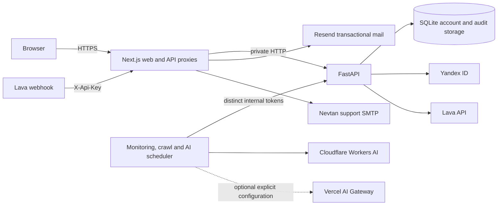

# WebDiag

WebDiag is a website diagnostics MVP with technical SEO and security tools, saved projects, audits, crawling, monitoring, reports and AI assistance. The interface supports Russian and English.

[Website](https://webdiag.ru) · [Application](https://app.webdiag.ru) · [Tool registry](packages/tool-registry/registry/tools.json) · [Verification history](docs/VERIFICATION.md) · [Provider repair evidence](docs/provider-repair-verification-2026-10-08.md) · [AI suite acceptance](docs/ai-suite-verification-2026-10-09.md)

The repository is a beta release (`1.0.0-beta.0`). A deployed version can differ from this source. A successful build, configured credentials and healthy containers are separate from a verified OAuth login, payment or delivered email.

## Capabilities

- 125 registry definitions: 115 public tools and 10 internal definitions replaced by public tools. Public builds exclude internal definitions from client bundles.
- Browser utilities for text, encoding, images and developer workflows; server tools for bounded website and infrastructure diagnostics.
- Email/password accounts, scrypt hashing, revocable sessions, projects and saved audit history.
- Yandex authorization code flow with PKCE and provider subject identities. Linking an existing email account requires proof of account ownership.
- Persistent crawl/monitoring jobs with ownership checks, budgets, deadlines and worker leases.
- Lava credit packs and monthly/annual plans. A verified payment settles credits and plan activation once in the account database.
- Fifteen AI workflows for saved audits, page content, structured data, migrations, localization, regular expressions and images. They require an enabled, configured runtime.
- Contact mail through Nevtan SMTP; registration and ownership confirmation mail through Resend.

## Architecture



The Dokploy core consists of `web`, `api` and `monitoring_scheduler`. Only `web:3000` is exposed to Dokploy's reverse proxy. All three services share a project-scoped `backend` network; web and scheduler address the API as `webdiag-api`, avoiding `api` aliases of other applications on the proxy network. API and worker endpoints stay private. The API owns persistent state in the `account_data` volume. Image uploads and results persist in the separate `ai_artifacts` volume shared only by API and worker. SQLite is the active storage layer; the core does not use PostgreSQL or RabbitMQ. Other Compose overlays describe optional development or AI topologies.

AI polling runs separately from the monitoring/crawl cycle. Workers use internal API endpoints instead of mounting the account database. AI jobs reserve credits before execution; validated outputs, lease ownership and terminal state determine settlement. Ambiguous provider outcomes remain subject to reconciliation.

```text
apps/web/               Next.js App Router, API proxies and interface
apps/api/               FastAPI, accounts, storage, audit, crawl, billing and AI contracts
apps/worker/            Monitoring/crawl execution, Cloudflare and Vercel AI adapters
packages/tool-core/     Shared TypeScript contracts and utilities
packages/tool-registry/ Tool definitions, localized content and availability
scripts/                Tests, build verification, dependency and Compose checks
docs/                   Specifications, operations notes and dated evidence
```

## Local development

Use Node.js 22–24, npm 10.9.2 and Python 3.14. npm and hashed Python lock files pin dependencies. Python commands use the repository `.venv`.

From a fresh checkout in PowerShell:

```powershell
npm ci
py -3.14 -m venv .venv
npm run python:install
```

Run the API in one terminal:

```powershell
node scripts/run-python.mjs -m uvicorn webdiag_api.main:app --host 127.0.0.1 --port 8000
```

Set `WEBDIAG_API_INTERNAL_URL=http://127.0.0.1:8000` in `apps/web/.env.local`, then run `npm run dev` in a second terminal. Open `http://localhost:3000`.

Development defaults use SQLite files under `.webdiag` and HTTP session cookies. OAuth requires the configured HTTPS callback origin. Use provider fixtures for local checks; do not point development OAuth at production or commit real credentials.

## Configuration

[.env.production.example](.env.production.example) lists core deployment settings. Keep real values in Dokploy or an untracked environment file. A variable set in Dokploy reaches a container only when its Compose service explicitly references it.

| Integration | Required settings and placement |
| --- | --- |
| Accounts | `WEBDIAG_ACCOUNT_PUBLIC_ORIGIN`; secure production cookies; separate account/audit database paths |
| Internal jobs | Distinct `WEBDIAG_MONITORING_INTERNAL_TOKEN` and `WEBDIAG_CRAWLER_INTERNAL_TOKEN`, 32–256 visible ASCII characters |
| Yandex | `WEBDIAG_YANDEX_CLIENT_ID` and `WEBDIAG_YANDEX_CLIENT_SECRET` on API; secret excluded from web |
| Legacy OAuth recovery | Distinct `WEBDIAG_ACCOUNT_INTERNAL_TOKEN`, shared only by API/web; working Resend configuration |
| Lava | `WEBDIAG_LAVA_API_KEY`, `WEBDIAG_LAVA_WEBHOOK_SECRET`, `WEBDIAG_LAVA_OFFER_ID`; unprefixed Lava aliases also accepted |
| Transactional mail | `RESEND_API_KEY`, `EMAIL_FROM=no-replay@webdiag.ru`; replies go to support |
| Support mail | `NEVTAN_SMTP_HOST`, `NEVTAN_SMTP_PORT`, `NEVTAN_SMTP_USER=support@webdiag.ru`, `NEVTAN_SMTP_PASS`, `CONTACT_RECIPIENT_EMAIL=support@webdiag.ru` |
| AI | `WEBDIAG_AI_RUNTIME_ENABLED=true`, distinct `WEBDIAG_AI_INTERNAL_TOKEN` / `WEBDIAG_AI_SAFETY_IDENTIFIER_SECRET`, executor-only credentials for the selected providers |

### Yandex ID

Register the exact Redirect URI `https://app.webdiag.ru/api/account/yandex/callback`, or the same callback path under the configured public origin. Scopes: `login:email` and `login:info`. Web creates random state and a PKCE verifier; only API exchanges the code and obtains the provider identity.

The first Yandex binding to an existing email account requires an emailed ownership code, even if local credentials already exist. This supports legacy OAuth accounts without a known local password. Codes expire after ten minutes, allow five attempts and have a persistent resend throttle. The private code-preparation endpoint requires the account bridge token. Recovery atomically invalidates prior sessions and the unverified local password; the confirmed owner continues signing in through Yandex ID. An already-linked subject signs in normally without resetting credentials. This prevents an attacker who preregistered another person's email from retaining access.

The login button uses the [official round Yandex asset](https://yandex.ru/dev/id/doc/ru/codes/buttons-design), stored in `apps/web/public/icons/yandex-id.svg`.

### Lava.top

Set `WEBDIAG_LAVA_OFFER_ID` to the **price ID (offer ID)**, not the product ID. Both are UUIDs, so checking the format alone cannot distinguish them. The Lava offer must permit **Price on request via API** for dynamic amounts. Retrieve products with `GET /api/v2/products?feedVisibility=ALL` to include offers hidden from the storefront and match the price to your WebDiag product. The provider origin is fixed to `https://gate.lava.top`. Configure `https://app.webdiag.ru/api/billing/lava/webhook` with its dedicated webhook **X-Api-Key**. The outbound API key and webhook secret serve different purposes.

Every invoice stores its owner, product, currency, amount, credits and plan period. A successful return query is not payment evidence. Confirmation retrieves the provider invoice and validates the completed receipt. Webhook settlement requires authenticated `payment.success` data matching the saved invoice. Unknown invoices, other users' invoices and mismatched payments cannot grant credits. Replayed callbacks cannot extend a plan or credit a balance twice.

Existing prices are preserved:

| Product | RUB | USD |
| --- | ---: | ---: |
| Pro, 30 days | 990 | 14 |
| Pro, annual | 9,480 (790/month equivalent) | 132 (11/month equivalent) |
| Team, 30 days | 2,990 | 42 |
| Team, annual | 28,680 (2,390/month equivalent) | 408 (34/month equivalent) |
| 50 AI credits | 390 | 5 |
| 150 AI credits | 890 | 12 |
| 500 AI credits | 1,990 | 28 |

Annual products are paid upfront for 365 days, without automatic renewal. Billing retains the existing monthly plan credit allocations (Pro 150, Team 500), with twelve allocations credited upfront for annual purchases. Product period and currency survive registration, OAuth and checkout.

Paid plan periods are retained individually. Same-tier renewal extends the paid term. Changing an active tier requires support rather than silently discarding prepaid days. Already-issued invoices that settle concurrently retain consecutive periods; confirmation reports the purchased period's start and expiry.

Checkout preserves the pending invoice in a session-bound HttpOnly cookie for up to one day. A Lava return restores the matching invoice and asks the server to verify it; redirect parameters cannot mark a payment successful. The cookie is cleared after a verified paid confirmation.

### Email

`support@webdiag.ru` is the Nevtan support mailbox. Nevtan handles incoming domain mail. Resend sends automated mail from `no-replay@webdiag.ru`; its sending-domain verification does not create a receiving mailbox. Keep root MX pointed at Nevtan for incoming support mail.

Verify Nevtan MX/SPF/DKIM and Resend's DKIM/return-path records against provider dashboards and authoritative DNS. Port 465 uses implicit TLS; port 587 requires STARTTLS. Certificate validation stays enabled. Check the actual SMTP hostname and authenticate from the deployed web container.

Successful registration schedules welcome mail with Next.js `after`, using the persisted email. New Yandex registrations receive it too. Missing credentials or rejected recipients produce failures, never simulated success. A Resend message ID proves acceptance; a delivery event and recipient readback prove delivery. Welcome mail has a bounded attempt without a durable retry outbox.

### AI runtime

Text/vision and image providers are selected independently. Set `WEBDIAG_AI_TEXT_PROVIDER=cloudflare` for Qwen 3.8 27B and `WEBDIAG_AI_IMAGE_PROVIDER=cloudflare` for FLUX.2 klein 4B. This configuration requires only the scoped `CLOUDFLARE_ACCOUNT_ID` and `CLOUDFLARE_API_TOKEN` on the AI executor, alongside the distinct internal secrets; the API receives provider policies, never provider credentials. Disabling the runtime hides runnable AI tools and rejects paid job creation.

The default `vercel` text policy retains `AI_PROVIDER=vercel`, `AI_GATEWAY_BASE_URL=https://ai-gateway.vercel.sh/v1`, `AI_MODEL=openai/gpt-6-luna`, `AI_REASONING_EFFORT=medium`. Its adapter validates these settings and requires `AI_GATEWAY_API_KEY`. Live verification on 2026-10-09 returned HTTP 403 for GPT-6 Luna with free Gateway credits, even with ZDR disabled. A positive free-credit balance does not prove that the selected model is accessible. Any policy that retains Vercel images still requires its credential.

The original 15 contracts cover audit action plans, meta tags, Schema.org, FAQ, alt text, content briefs, page revisions, search intent, competitor gaps, internal linking, redirect migration, localization, regular expressions, image generation and image editing. The thirteen text/vision tools cost one credit per successful run; image generation and editing retain their two-credit price. Each runner displays the server catalog price before submission. There is no heuristic provider or hidden model fallback. Prove a real run through job state, output, provider outcome and the credit ledger before claiming production provider success.

Image routing is an explicit deployment policy. `WEBDIAG_AI_IMAGE_PROVIDER=vercel` retains `openai/gpt-image-2`; the free-credit tier rejects that model and requires purchased Gateway credits. `WEBDIAG_AI_IMAGE_PROVIDER=cloudflare` uses `@cf/black-forest-labs/flux-2-klein-4b` through the Workers AI REST API for generation and editing. Set `CLOUDFLARE_ACCOUNT_ID` and `CLOUDFLARE_API_TOKEN` in Dokploy; credentials reach only the AI executor, while the API receives the provider selection to record the actual model on each new run. Existing runs retain their recorded model; a mismatched model fails before a provider request. There is no automatic provider fallback.

Cloudflare text and vision requests use the account-scoped OpenAI-compatible endpoint, strict JSON Schema, low reasoning effort, a bounded output-token budget and `store=false`. The same tool contracts validate both providers' responses; the API also checks evidence references and source constraints before completion. Alt-text input is resolved from private storage, checked against its recorded hash and size, normalized and sent inline. Provider responses are bounded at 2 MiB; redirects and automatic retries are disabled. Cloudflare reports tokens and neurons, but not a dollar receipt, so unreported monetary cost remains `null`. Text and images share the Workers AI daily quota. Free-plan quota exhaustion fails explicitly and never activates billing.

FLUX.2 klein 4B uses four fixed inference steps. The existing quality selector changes output resolution: low, medium and high target approximately 512, 1024 and 1536 pixels per square side; aspect ratio and the provider's 1920-pixel side limit can adjust the actual dimensions. Reference images are normalized, stripped of metadata and resized to fit 511 by 511 pixels, preserving aspect ratio, before editing. Cloudflare's Free plan supplies a shared daily quota; exhaustion rejects a request rather than enabling a paid plan. WebDiag does not provision billing or cloud storage. The server validates returned inline PNG, JPEG or WebP data, canonicalizes Cloudflare output to PNG and persists it to the leased reservation. Canonical PNG remains byte-identical during API integrity validation and download; lossy output is never recompressed during those checks. An ambiguous image request is never automatically resubmitted, and unreported cost remains unknown rather than being labeled free. See [Cloudflare's model and API requirements](https://developers.cloudflare.com/changelog/post/2026-01-15-flux-2-klein-4b-workers-ai/).

Vercel text retention is an explicit operator policy: `WEBDIAG_AI_REQUIRE_ZDR` defaults to `true`; setting it to `false` omits the request-level ZDR restriction without changing models or retrying a rejected request with weaker privacy. Invalid values prevent the Vercel adapter's initialization. The operator approved `false` for Hobby. This setting does not impose ZDR on Cloudflare; both localized privacy policies disclose the selected processing services and possible provider retention. ZDR requires a compatible Vercel plan. A valid key and positive free balance alone do not establish readiness. See the [dated acceptance evidence](docs/ai-suite-verification-2026-10-09.md) for actual provider outcomes.

Gateway-reported usage is retained. If an image response omits its optional cost, the attempt stores an unknown cost (`NULL`), preserves the verified result and excludes that attempt from measured cost statistics. An unavailable cost is never recorded as a free generation.

Production stores images on the deployment server: `WEBDIAG_AI_ARTIFACT_STORAGE=local` and `WEBDIAG_AI_ARTIFACT_LOCAL_ROOT=/var/lib/webdiag-ai-artifacts`. The Compose files mount the persistent `ai_artifacts` volume at that path in API and worker. Web has no filesystem access to it. Downloads pass through authenticated ownership checks; neither public filesystem paths nor provider image URLs are exposed. Individual files are limited to 4 MiB and written atomically with private permissions. This topology does not require an S3 account.

## Verification

```powershell
npm run verify:registry
npm test
npm run lint
npm run typecheck
npm run test:python
npm run lint:python
npm run verify:python-lock
$env:PUBLIC_RELEASE = "true"
npm run build
npm run test:browser
npm run test:dokploy-compose
```

Browser checks require `npx playwright install chromium` or `PLAYWRIGHT_CHROMIUM_EXECUTABLE_PATH` pointing to an installed compatible browser. Tests use fixtures; they do not charge a Lava invoice, send production mail or certify a live AI provider. Compose checks render configuration without starting containers.

The build gate checks registry availability, localized metadata/JSON-LD and absence of internal tools in public bundles. Provider regressions cover OAuth state/PKCE, account ownership, recovery limits, invoice ownership, amount/currency validation, replay/concurrent settlement and failure paths. Image checks decode real AVIF bytes and verify orientation/dimensions.

## Dokploy operations

Use `docker-compose.dokploy.yml` for the three-service core. Validate its effective configuration before deployment:

```powershell
npm run verify:dokploy-compose -- --env-file .env.production
```

Keep `.env.production` untracked. Inspect Patches/Preview Compose as well as repository YAML: a full-file patch can override configuration. Check running-container settings without logging credentials.

In Dokploy Advanced → Networks, detach `api` and `monitoring_scheduler` from `dokploy-network`, keeping `web` connected for Traefik. Preserve the repository `backend` network on all services. Validate `http://webdiag-api:8000/ready` from web after deployment: an API healthcheck alone cannot detect a web request reaching another application's `api` alias. The legacy Isolated Deployment switch is not required for this topology.

Back up SQLite with its backup API or a stopped-writer procedure. Preserve matching account/audit databases and recovery instructions; copying only the main database while WAL writes continue is unsafe. Readiness does not prove restore capability.

Include the `ai_artifacts` volume in the same recovery procedure as the account database: database metadata alone cannot restore images. Do not remove named volumes during redeployment. Monitor disk capacity; successful image results remain until their owner deletes them. A server-local volume survives container replacement but does not itself provide an off-server backup.

After deployment, confirm commit identity, container readiness and changed flows. Keep sanitized provider receipts separate from local test results. **On Push autodeploy** means publishing to the tracked branch starts a production rollout; local tests or GitHub review alone do not approve that operation.

## MVP limits

- SQLite and current workers target a single deployment. Horizontal writes and multi-region operation need a different coordination design.
- Existing pricing descriptions are retained. Billing persists plan/payment/credits, but project/history quotas, seats, white-label reports and priority queues are not all enforced from plan state. Plan activation does not certify those entitlements.
- The core crawler budget is 100 pages, independently of advertised plan limits. AI activation still requires a configured worker, private artifact storage and deployed provider acceptance checks.
- Monitoring persists results and notification events. Contact SMTP does not certify a complete monitoring email alert pipeline.
- Welcome mail has no durable retry queue. Acceptance does not guarantee inbox placement.
- Fixtures and local checks do not establish live payment, email or AI delivery; those require separate deployed acceptance checks.

## Contributing and security

Keep design/commercial pricing changes separate from behavioral fixes. Reproduce defects, check changed behavior and preserve ownership/session boundaries. Never expose provider secrets, raw exceptions or synthetic success. Use bounded requests and SSRF controls in network tools.

Current versions: Next.js 16.3.4, React 19.2.8, FastAPI 0.139.1. Review pinned versions in lock files and Python project metadata. Report vulnerabilities privately to `support@webdiag.ru`, without credentials or exploit details in public issues.

No redistribution license is included. Obtain the owner's permission before reusing the source.
